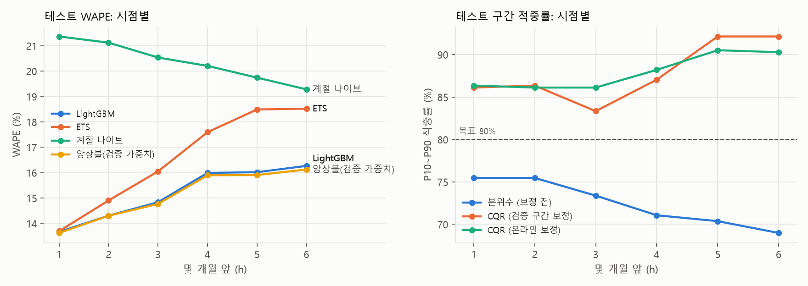

# ABS·PC 수출 수요예측 연습 (공개 데이터)

한국의 ABS·PC 월별 수출 물량을 상대국별로 1~6개월 앞까지 예측하고, 그 결과를 **미리 정해 둔 절차로 정직하게 평가**한 연습 프로젝트입니다.
LOTTE AX Challenge 2026의 '롯데케미칼 첨단소재(ABS·PC·컴파운드) 수요예측 AI' 과제에 지원하면서, 지원서에 쓴 설계(기준선 → 글로벌 LightGBM → 롤링 백테스트 → 부트스트랩 → 확률 예측)를 공개 데이터로 직접 확인해 보려고 만들었습니다.

> **실제 판매 데이터가 아닙니다.** 한국 전체 수출 통계(UN Comtrade)이고, 롯데케미칼의 등급 x 고객 데이터와는 다릅니다. 이 저장소의 정확도 숫자는 그대로 옮겨 갈 수 없고, 옮겨 갈 수 있는 것은 **평가 방법**입니다. 한계는 [아래](#데이터의-한계)에 정리했습니다.

## 문제

- 예측 대상: 제품(ABS = HS 390330, PC = HS 390740) x 상대국 x 월의 수출 물량(톤).
- 시리즈 18개: 제품별 상위 8개국 + 기타(나머지 나라 합계). '제품 x 국가 x 월' 구조가 과제의 '등급 x 고객 x 월'과 닮아서 골랐습니다.
- 기준 시점 T(실제값을 아는 마지막 달)마다 T+1 ~ T+6월을 예측하고, 모든 모델을 그때까지의 데이터로 다시 학습합니다.

## 데이터

| 자료 | 내용 | 받는 방법 |
|---|---|---|
| UN Comtrade | 한국(410) 수출, HS 390330·390740, 전체 상대국, 월별 순중량(kg)·금액(USD), 2015-01 ~ 2025-12 | 공개 API (키 필요 없음), 132번 호출 |
| FRED `EXKOUS` | 원/달러 환율 월평균 | 키 없는 CSV |
| FRED `MCOILBRENTEU` | 브렌트유 월평균 (EIA) | 키 없는 CSV |

- 2026년 자료가 없는 이유: 한국 월별 자료는 Comtrade에 1년치씩 몰아서 올라옵니다 (2025년치는 2026-05-20 공개). 관세청 공공데이터포털 API는 더 최신이지만 키가 필요해서 이번에는 쓰지 않았습니다.
- 확인한 품질: 매달 World 행이 상대국 합계와 정확히 같고, 물량 단위는 kg, 추정값 표시가 없습니다. 거래가 없는 달은 행이 빠져 있어 0으로 채웠습니다. PC 2017-09·2025-08에는 작은 상대국 행 하나씩(스위스 0.5 kg, 핀란드 800 kg)의 순중량이 비어 있어 그달 World 행까지 비어 있었습니다. 같은 행의 kg 단위 대체 수량(`altQty`)으로 채웠습니다 (4행).
- 상위 8개국은 첫 검증 기준 시점(2022-02)까지의 24개월 물량으로 골랐습니다. 목록과 비중은 [`outputs/series_info.csv`](outputs/series_info.csv)에 있습니다.
- 원자료는 저장소에 넣지 않았습니다. `run_all.py`가 처음 실행될 때 받아 `data/raw/`에 저장합니다. 동결 때의 원자료는 값만으로 만든 지문 [`data/content_hash.json`](data/content_hash.json)으로 확인합니다. 파일별 SHA-256([`data/manifest.json`](data/manifest.json))은 응답에 서버 처리 시간이 들어 있어 원래 캐시 파일과만 일치합니다.

### 데이터의 한계

1. 한국의 모든 ABS·PC 수출사 합계입니다. 롯데케미칼 판매가 아닙니다.
2. HS 6단위 코드 하나에 여러 등급이 섞여 있습니다. PC/ABS 얼로이 같은 컴파운드는 HS 혼합물 분류 규칙에 따라 이 코드나 다른 코드로 들어가서, 컴파운드 수요를 따로 볼 수 없습니다.
3. 내수 판매가 빠져 있습니다.
4. 날짜는 수출 신고 기준입니다. 주문·매출 인식 시점과 다르고, 해외 자기 공장으로 보내는 물량도 수출로 잡힙니다.
5. 상대국은 신고된 목적지입니다. 홍콩 같은 중계지는 실제 수요지가 아닐 수 있습니다.
6. 백테스트는 T월 자료를 T+1월 중순에 안다고 가정합니다 (관세청 확정치 발표 시점). 실제 Comtrade 공개는 훨씬 늦고, 쓰인 값은 최신 수정본이라 그 달에 처음 발표된 값과 다를 수 있습니다. 최근 값을 많이 쓰는 모델에 조금 유리한 쪽입니다.
7. 국가 합계는 오차가 서로 상쇄돼 고객 단위보다 훨씬 매끈합니다. 등급 x 고객 단위 예측의 WAPE는 이보다 훨씬 높을 가능성이 큽니다.
8. 테스트는 한 기간(기준 시점 24개, 예측 대상 29개월)뿐이라 불확실성이 큽니다.
9. 구간 적중률은 경험적 확인입니다. 시계열은 conformal 보장의 전제(교환 가능성)를 만족하지 않습니다.
10. 테스트 구간이 완전히 '처음 보는' 자료는 아니었습니다. 데이터 경로를 확인하면서 2024~2025년 연간 합계와 2024년 월별 World 물량, 2025-12 World 물량을 봤습니다 ([WORKLOG.md](WORKLOG.md) 3절). 모델 점수는 보지 않았고, 설계는 그 전에 정한 초안과 데이터를 보지 않은 검토 의견을 따랐습니다.

## 방법

### 분할 (모두 결과를 보기 전에 정함)

| 구간 | 기준 시점 | 예측 대상 월 | 쓰임 |
|---|---|---|---|
| 상위국 선정 | 2020-03 ~ 2022-02의 물량 | - | 제품별 상위 8개국 |
| 검증 | 2022-02 ~ 2023-01 (12개) | 2022-03 ~ 2023-07 | LightGBM 설정, 외부 지표 사용 여부, 앙상블 가중치, 구간 보정폭 선택 |
| 테스트 | 2023-07 ~ 2025-06 (24개) | 2023-08 ~ 2025-12 | `frozen.json` 고정 후 한 번만 채점 |

검증에서 고른 것은 모두 [`frozen.json`](frozen.json)에 쓰고 git 태그 `freeze`를 단 뒤에만 테스트를 돌렸습니다. `run_all.py --stage final`은 이 파일이 없으면 실행되지 않습니다.

### 모델

| 모델 | 설명 |
|---|---|
| 계절 나이브 | 목표 월의 1년 전 값 |
| 12개월 평균 | 참고용. LightGBM이 정규화 기준 이상으로 배운 것이 있는지 확인 |
| AutoETS | 시리즈마다 오차·추세·계절 형태를 AICc로 자동 선택 (statsforecast) |
| LightGBM 글로벌 | 18개 시리즈 x 1~6개월 앞을 한 모델로 직접 예측. 목표 = 값 / 최근 12개월 평균, L1 손실 x 규모 가중 (= WAPE 분자) |
| 앙상블 | 계절 나이브·ETS·LightGBM을 0.1 단위 가중치로 섞음 (66가지 중 검증에서 선택). 1/3씩 섞은 것도 참고로 봄 |

- LightGBM 피처(모두 기준 시점 이하 값): 래그 0~11, 3·6개월 평균, 작년 12개월 평균, 목표 월의 1·2년 전 값, 목표 월, h, 제품, 국가, log(규모). 외부 지표(환율·브렌트유의 1·12개월 변화율)는 검증 구간에서 넣은 것과 뺀 것을 비교해 P >= 0.9일 때만 쓰기로 했습니다.
- 하이퍼파라미터: 조합 972개 중 30개를 시드 고정으로 뽑아 검증 WAPE가 가장 낮은 것을 골랐습니다.
- Croston/TSB: 간헐성 검사(ADI > 1.32)에 걸리는 시리즈가 없어 쓰지 않았습니다 ([`outputs/intermittency.csv`](outputs/intermittency.csv)).

### 평가

- 지표: WAPE(물량 가중), 편향(+는 과대 예측), MASE(계절 나이브 오차 대비, 시리즈 평등). 전체·시점별·제품별·시리즈별.
- 블록 부트스트랩: 테스트 기준 시점 24개를 길이 6 원형 블록으로 다시 뽑아 10,000번 짝 비교합니다. 블록 수가 적어 생기는 분산 축소를 sqrt(n/(n-b))로 보정했습니다. 주 지표는 'LightGBM의 WAPE가 계절 나이브와 ETS 둘 다보다 낮은 재표집 비율'입니다. 검증 구간에서 쓴 P(외부 지표 판단 등)는 기준 시점 12개, 블록 2개로 계산해서 테스트보다 훨씬 거칩니다.
- 선택 편향: 설정 30개 전부를 (동결 후, 진단용으로만) 테스트에서도 돌려, 고른 설정이 '보통 설정'보다 얼마나 더 나빠졌는지 로그 비율로 쟀습니다.
- 확률 예측: LightGBM q10·q90 + CQR(아래·위 따로, h별). 검증 구간 오차로 보정한 것이 주, 테스트 중 실제값이 나온 오차를 더해 가는 온라인 보정이 보조입니다.
- 누수 테스트: [`tests/test_no_leakage.py`](tests/test_no_leakage.py)가 기준 시점 이후 값을 엉터리로 바꿔도 예측이 비트 단위로 같은지 확인합니다.

개념 설명은 [LEARNING.md](LEARNING.md), 작업 기록은 [WORKLOG.md](WORKLOG.md)에 있습니다.

## 결과 (테스트 기준 시점 24개, 18개 시리즈 x 1~6개월 앞)

<!-- AUTO:summary_table:START -->
| 모델 | 테스트 WAPE | 편향 | MASE |
|---|---|---|---|
| 계절 나이브 | 20.4% | 0.0% | 0.892 |
| ETS | 16.5% | +1.3% | 0.777 |
| LightGBM | 15.2% | -0.3% | 0.697 |
| 앙상블(검증 가중치) | 15.1% | -0.1% | 0.691 |

- P(LightGBM의 WAPE < ETS) = 1.000, P(< 계절 나이브) = 1.000, P(둘 다) = 1.000 (블록 부트스트랩, 블록 6, 10,000회, 작은 표본 보정)
- P10~P90 적중률(목표 80%): 보정 전 72.5% -> CQR 보정 후 87.8%
<!-- AUTO:summary_table:END -->



### 읽는 법 (숫자는 모두 [RESULTS.md](RESULTS.md)에서 옮김)

1. **LightGBM이 두 기준선보다 나았습니다.** 테스트 WAPE 15.2%로 ETS 16.5%보다 상대적으로 8.2% 낮았습니다 (90% 구간 5.2% ~ 11.2%). 미리 정한 기준(P >= 0.9)을 넘었습니다 (P = 1.000). 기준 시점 24개 중 19개에서 ETS보다 나았고, 연속 6개 기준 시점을 묶은 블록은 모두 LightGBM 쪽이 나았습니다. 그래도 서로 겹치지 않는 6개월 블록은 4개뿐이라 P = 1.000을 '확실하다'로 읽지는 않습니다.
2. **이득은 먼 시점에서 나왔습니다.** 1개월 앞은 LightGBM과 ETS가 13.7%로 같았고 (1개월 앞만 따로 본 블록 3 부트스트랩에서 P = 0.542), 6개월 앞은 16.3% 대 18.5%였습니다.
3. **모든 시리즈에서 이긴 것은 아닙니다.** 18개 중 4개 시리즈에서 ETS가 나았습니다. 테스트 물량 1위인 ABS-기타(ETS 9.6%, LightGBM 11.8%)와 4위인 ABS-중국(12.3%, 13.8%), 그리고 ABS-멕시코와 PC-헝가리입니다. '기타'를 뺀 16개 국가 시리즈만 보면 LightGBM 16.5%, ETS 19.3%입니다.
4. **하이퍼파라미터 탐색은 거의 의미가 없었습니다.** 설정 30개의 검증 순위와 테스트 순위의 상관은 -0.120이었고, 검증에서 고른 설정은 테스트에서 24등이었습니다. 다만 사후 1등과의 차이는 0.34%p로 작아서, 어떤 설정을 골라도 결과가 비슷했습니다.
5. **외부 지표는 규칙대로 뺐습니다.** 검증 구간에서 환율·유가를 넣은 쪽이 나을 P가 0.726이라 쓰지 않았습니다. 사후에 보니 넣은 쪽의 테스트 WAPE가 14.7%로 더 낮았지만, 테스트를 보고 바꾸지 않았습니다.
6. **구간 보정은 너무 넓어졌습니다.** 보정 전 P10~P90 적중률은 72.5%로 좁았고, 검증 구간 오차로 CQR 보정한 뒤에는 87.8%로 목표 80%를 넘었습니다 (90% 구간 82.8% ~ 92.1%). 검증 구간이 수출 감소기라 아래쪽 경계를 크게 넓혔는데, 테스트 구간에서는 아래로 벗어난 비율이 0.8%뿐이었습니다. 폭과 이탈을 함께 보는 구간 점수는 보정 전(0.727)이 보정 후(0.771)보다 좋았습니다. 보정에 쓰는 기간을 어떻게 고를지가 다음 과제입니다.
7. **테스트 기간이 검증 기간보다 쉬웠습니다.** LightGBM WAPE가 검증 23.7%에서 테스트 15.2%로 내려갔습니다. 설정 30개의 중앙값으로 보면 기간 효과가 -37.9%였습니다.

그 밖의 그림: [기준 시점별 차이](outputs/figures/fig_origin_diff.png), [선택 편향](outputs/figures/fig_selection_bias.png), [1개월 앞 예측과 P10~P90](outputs/figures/fig_fan.png).

## 재현

Windows / Python 3.12, CPU만 씁니다. 한 줄로:

```bash
python -m venv .venv && .venv/Scripts/python -m pip install --only-binary=:all: -r requirements.txt && .venv/Scripts/python run_all.py
```

- 처음 실행하면 Comtrade 132개월을 받습니다 (약 15~25분, 호출 사이 2초 대기). 이후에는 `data/raw/` 캐시를 씁니다. 모델 계산은 검증 단계 약 5분, 테스트 단계 약 10분입니다.
- `frozen.json`이 있으면 검증 단계를 다시 돌려 같은 선택(LightGBM 설정, 외부 지표 사용 여부, 앙상블 가중치, 구간 보정폭)이 나오는지 확인합니다. 다르면 멈춥니다. 같으면 동결본으로 테스트를 채점하고 `outputs/results.json`, 그림, `RESULTS.md`, README·SUMMARY의 자동 표를 다시 만듭니다 (커밋된 파일을 덮어씀).
- 원자료 값이 동결 때와 다르면(Comtrade 수정 등) 경고가 나오고 `RESULTS.md`에도 표시됩니다.
- 단계별 실행: `--stage val`, `--stage final`, `--stage report`. `final`은 같은 PC에서 먼저 돌린 `val`의 `outputs/val_*` 파일이 필요하고, `report`의 그림과 기준 시점별 승패 문단은 `final`이 만든 예측 파일이 필요합니다 (이 파일들은 커밋하지 않음). 원자료를 다시 받으려면 `--refresh`.
- 누수 테스트: `.venv/Scripts/python -m tests.test_no_leakage`

## 폴더

```
tsa/            코드 (config, 수집, 패널, 기준선, LightGBM, 부트스트랩, conformal, 단계, 보고서)
tests/          누수 테스트
frozen.json     검증 단계에서 고정한 선택
outputs/        결과 JSON, 그림, 시리즈 정보
data/content_hash.json  동결 때 원자료 값의 지문
data/manifest.json      원자료 파일별 체크섬
```

## 출처

- UN Comtrade Database, United Nations Statistics Division. https://comtradeplus.un.org
- 원/달러 환율 `EXKOUS`: Board of Governors of the Federal Reserve System (G.5, 일별 값의 월평균), FRED 경유.
- 브렌트유 `MCOILBRENTEU`: U.S. Energy Information Administration, FRED 경유.
