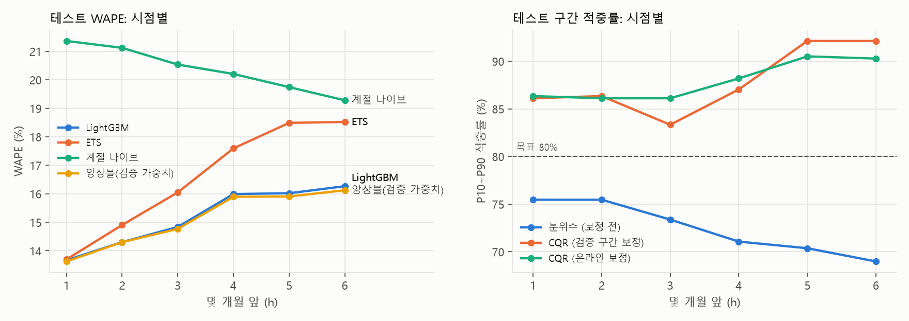

# 요약 (지원서·포트폴리오용)

숫자는 모두 [RESULTS.md](RESULTS.md)(실행 결과에서 자동 생성)에서 옮겼습니다.

## 지원서용 3줄

1. 실무 데이터 경험이 없어, 공개 수출 통계(UN Comtrade, 한국 ABS·PC 수출 2015 ~ 2025)로 '제품 x 국가 x 월' 18개 시리즈의 1 ~ 6개월 수요예측을 직접 구현했습니다 (롯데케미칼 판매 데이터는 아닙니다).
2. 설정·가중치·구간 보정은 앞쪽 검증 구간에서만 골라 동결한 뒤 테스트 기준 시점 24개를 한 번만 채점했고, 미래 값을 바꿔도 예측이 같은지 누수 테스트로 확인했습니다.
3. 글로벌 LightGBM의 WAPE는 15.2%로 ETS 16.5%, 계절 나이브 20.4%보다 낮았지만, 1개월 앞과 가장 큰 시리즈에서는 ETS와 같거나 나빴고, 구간 보정은 목표 80%보다 넓게(87.8%) 나와 보정 기간 선택이 과제로 남았습니다.

## 포트폴리오 1쪽

### ABS·PC 수출 수요예측: 공개 데이터로 확인한 평가 절차

**무엇을**: 한국의 ABS·PC 월별 수출(UN Comtrade, 2015-01 ~ 2025-12)을 제품별 상위 8개국 + 기타, 18개 시리즈로 나눠 1~6개월 앞을 예측했습니다. '제품 x 국가 x 월'을 과제의 '등급 x 고객 x 월' 대신 썼습니다. 실제 판매 데이터가 아닙니다.

**어떻게**: 계절 나이브·ETS 기준선과 18개 시리즈를 한 번에 학습하는 LightGBM을 비교했습니다. 기준 시점을 한 달씩 옮기는 롤링 백테스트로 평가했고, 설정·가중치·구간 보정폭은 앞쪽 검증 구간(기준 시점 12개)에서만 골라 `frozen.json`에 고정한 뒤 뒤쪽 테스트 구간(기준 시점 24개)을 한 번만 채점했습니다. 미래 값을 망가뜨려도 예측이 같은지 보는 누수 테스트를 두었습니다.

**결과** (테스트, 18개 시리즈 x 24개 기준 시점 x 1~6개월 앞)

<!-- AUTO:summary_table:START -->
| 모델 | 테스트 WAPE | 편향 | MASE |
|---|---|---|---|
| 계절 나이브 | 20.4% | 0.0% | 0.892 |
| ETS | 16.5% | +1.3% | 0.777 |
| LightGBM | 15.2% | -0.3% | 0.697 |
| 앙상블(검증 가중치) | 15.1% | -0.1% | 0.691 |

- P(LightGBM의 WAPE < ETS) = 1.000, P(< 계절 나이브) = 1.000, P(둘 다) = 1.000 (블록 부트스트랩, 블록 6, 10,000회, 작은 표본 보정)
- P10~P90 적중률(목표 80%): 보정 전 72.5% -> CQR 보정 후 87.8%
<!-- AUTO:summary_table:END -->

**해석과 한계**

- LightGBM은 ETS보다 WAPE가 상대적으로 8.2% 낮았고 (90% 구간 5.2% ~ 11.2%), 이득은 먼 시점에서 나왔습니다. 1개월 앞은 두 모델이 13.7%로 같았습니다.
- 18개 중 4개 시리즈에서는 ETS가 나았고, 테스트 물량 1위인 ABS-기타가 그중 하나입니다. 하이퍼파라미터 설정 30개의 검증 순위는 테스트로 이어지지 않았습니다 (순위 상관 -0.120).
- 구간은 보정 전에 좁았고 (72.5%), 수출 감소기였던 검증 구간으로 보정하자 너무 넓어졌습니다 (87.8%). 보정 데이터의 기간이 결과를 좌우했습니다.
- 합계 맞추기(7번)는 검증에서 미리 정한 규칙대로 가장 단순한 BU를 골랐습니다. 같은 구간으로 추정·평가하면 MinT가 크게 좋아 보였지만 (하위 WAPE 19.3% vs BU 23.7%), 나눠서 평가하자 나빴고 (24.7%) 테스트에서도 하위 수준은 BU가 나았습니다 (15.2% vs 16.3%).
- 질의응답 에이전트(7번)는 답변의 숫자가 도구 결과에 있는지 자동으로 검사합니다. 로컬 7B 모델로 돌리자 숫자 검사는 10/10 통과했지만, 뜻까지 맞는 답은 3/10이었습니다.
  - 고친 버전은 두 개입니다. 2차는 검사와 안전장치를 더했습니다. 3차는 구조를 바꿔, LLM은 코드가 만든 사실 문장의 id만 고르게 했습니다.
  - 고칠 때 보지 않은 새 질문 10개(테스트2, 기록일 뿐 확인할 장치는 없음)로 세 버전을 한 번씩 돌렸습니다. 뜻까지 맞은 답은 처음 5/10, 2차 4/10, 3차 5/10으로 비슷했습니다 (짝 비교 p = 1.000). 1차 테스트·테스트2의 답 50개를 버전 이름을 가리고 다시 검토해도 통과 판정 48개가 같았고, 결론도 같았습니다 (같은 Claude 검토자라 판정이 맞다는 확인은 아닙니다).
  - 3차 답에서는 숫자에 엉뚱한 이름표를 붙인 경우가 없었습니다. 문장을 코드가 쓰니 거의 당연합니다 ('주장이 모두 맞음' 8/10, 결과를 본 뒤 고른 지표). 하지만 틀린 대상(ABS 대신 전체 합계, 데이터에 없는 독일 대신 ABS)과 틀린 거절(기준 시점을 잘못 넣자 범위 안의 질문을 거절)은 남았습니다.
  - 같은 처음 에이전트가 질문 묶음에 따라 2/10(가린 재검토 3/10), 5/10이 나왔습니다. 질문 10개로는 버전 차이를 가릴 수 없습니다.
- 한국 전체 수출사의 국가 합계라 고객 단위보다 훨씬 매끈합니다. 정확도 숫자는 옮겨 갈 수 없고, 옮겨 갈 수 있는 것은 동결·롤링 백테스트·블록 부트스트랩·구간 보정이라는 평가 절차입니다.
